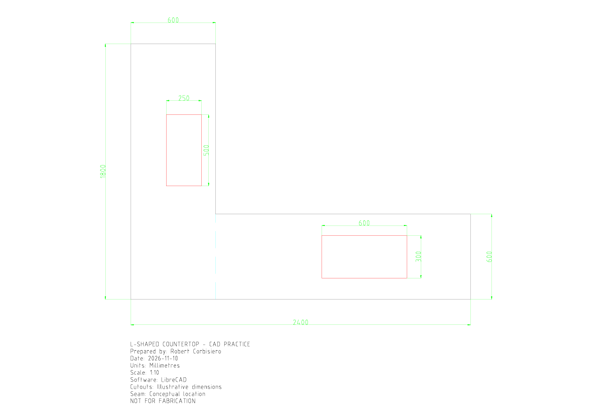

# L-Shaped Countertop — LibreCAD Practice Project

Beginner 2D CAD drafting exercise: an L-shaped kitchen countertop with illustrative sink and cooktop openings, dimensions, and a conceptual seam. Created as an independent learning project in preparation for a CAD-related manufacturing interview.

**Not for fabrication.** The drawing is conceptual, not approved for manufacturing or CNC use.

## Specifications

| Feature | Dimensions |
| --- | --- |
| Overall extents | 2400 × 1800 mm |
| Countertop depth | 600 mm |
| Sink opening | 250 × 500 mm (illustrative) |
| Cooktop opening | 600 × 300 mm (illustrative) |
| Proposed seam | x = 600 mm, y = 0–600 mm |
| Drawing units | Millimetres |
| PDF scale | 1:10 |
| Software | LibreCAD |

## Project files

- [Editable DXF](drawings/RocArtz_Countertop_Practice.dxf)
- [PDF drawing](drawings/RocArtz_Countertop_Practice.pdf)

## Skills practiced

- Coordinate-based drafting
- CAD layers for outlines, cutouts, seams, dimensions, and notes
- Dimension annotations and print layout
- DXF saving and PDF export

## Before production

Actual fabrication would require verified site measurements, manufacturer templates, corner radii, material-specific clearances, approved seams, support/overhang requirements, and appropriate CNC instructions.

## Attribution

Personal learning project by Robert Corbisiero. Not commissioned, reviewed, or endorsed by RocArtz.
